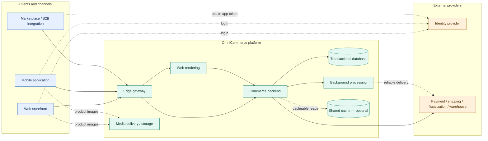
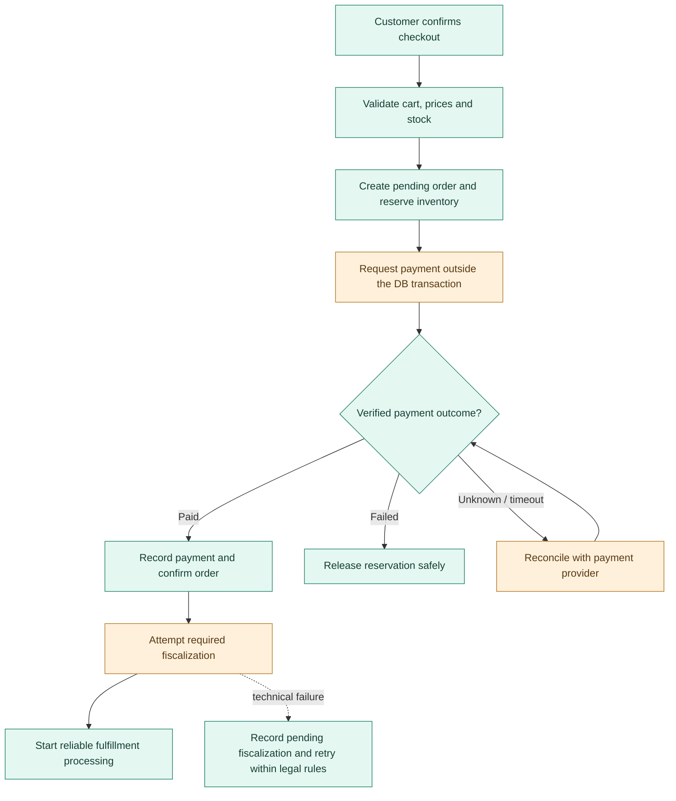

# OmniCommerce — High-Level System Architecture

## 1. What we are designing

OmniCommerce is a proposed retail platform that allows a business to sell products through a website, mobile applications, marketplaces and B2B integrations. The same backend should apply consistent pricing, inventory and ordering rules regardless of where a purchase begins. Two cross-functional teams will build and maintain the platform.

This document describes a **proposed production system**. The accompanying prototype is deliberately smaller: it implements a Cart Web API to demonstrate a few important backend practices.

The brief calls for millions of daily users, secure transactions, real-time processing, scalability, external integrations, monitoring and a delivery plan. It does not provide exact traffic volumes, catalog size or availability requirements. The numbers below are **planning assumptions**, not facts supplied by the client.

## 2. Requirements and assumptions

### What the platform needs to do

Customers need to find products, add them to a cart, pay for an order and follow its progress. The business needs a web administration area for products, prices and orders. External marketplace and B2B channels need a way to submit or retrieve relevant information without bypassing the same backend business rules.

Search, shipping, payment integration and the administration interface are **reasonable additions to the brief**, not detailed specifications from it. Their exact behavior would be confirmed with stakeholders.

### How well it needs to work

The platform must remain responsive during traffic peaks, keep financial and stock information consistent, protect customer data and recover from failures in external systems. It also needs to be understandable and maintainable by two teams.

These suggested targets give us something to test against. They would need business approval and verification before being treated as commitments.

| Measure | Illustrative target | Important qualification |
|---|---|---|
| Typical API latency (p95) | Under 300 ms | Excludes end-to-end external payment and shipping delays |
| Monthly availability | 99.9% | Measurement scope must be agreed |
| Recovery point objective (RPO) | At most 5 minutes | Confirmed payments/orders may require stricter protection and reconciliation |
| Recovery time objective (RTO) | At most 1 hour | Must be tested through recovery exercises |
| Technical checkout failure rate | Below 0.1% | Excludes declined payments, insufficient stock and customer cancellations |

### How much traffic and data should we plan for?

For an initial sizing discussion, assume:

| Assumption | Illustrative volume | Why it matters |
|---|---:|---|
| Daily active users | 3 million | The API must scale and tolerate failures |
| Backend API calls per user/day | 20 | About 60 million calls/day |
| Average / 10× peak API load | ~694 / ~6,944 requests/sec | Capacity must be tested for peaks, not just averages |
| Products | 1 million | Search needs indexes, filters and pagination |
| Images | 5 per product, ~300 KB each | Roughly 1.5 TB of image objects before variants and replicas |
| Images viewed per user/day | 10 | Up to ~9 TB/day transferred before caching and optimization |
| Catalog-related requests | 80% of API calls | Repeated reads may justify a shared cache |
| Orders | 100,000/day, 3 lines each | Roughly 36.5 million orders and 109.5 million lines/year |

These numbers are not a hardware specification. In particular, we **cannot infer how many containers we need from request counts alone**. A request may spend most of its time waiting for a database or another service rather than using CPU.

We would begin load testing with a representative instance (for example, **2 vCPU and 4 GB RAM**), measure different kinds of requests, and scale from the results. Tests should cover response times (including p95/p99), CPU, memory, database load and connection usage. No fixed number of replicas is proposed yet.

The figures do, however, point to sensible starting decisions. Product images should not fill the transactional database: object storage and a CDN can deliver them directly to customers. Product lookups need good indexes; a selective Redis cache may help if measurements show that the same data is read repeatedly. Checkout and inventory need reliable transactions even when many customers order at once.

## 3. Overall architecture

The diagram shows **what each part does**, rather than making individual cloud products the focus. Our platform is grouped separately from customers and external providers. Normal request paths use solid arrows; supporting authentication and background interactions use labeled dashed arrows.

**Legend:** Blue = client/channel; green = our platform; orange = outside provider. **Solid arrow** = normal service request or dependency; **dashed arrow** = separately labeled supporting interaction. The identity provider does not initiate shopping requests: users contact it when signing in, then use their access token to call our API.

| Component | What it does | Suggested technology |
|---|---|---|
| Edge gateway | Handles HTTPS, routes traffic and protects public endpoints | Azure Front Door (CDN/WAF) |
| Web storefront / rendering | Displays pages; server-renders product pages, prebuilds static pages and renders cart/account interactions in the browser | React or Angular, hybrid SSR/SSG/CSR |
| Commerce backend | Contains the shared commerce rules and APIs | ASP.NET Core on **.NET 8**, Azure Container Apps |
| Transactional database | Stores authoritative products, carts, orders, inventory and app-managed roles | Managed SQL Server / Azure SQL, EF Core |
| Media delivery / storage | Stores product images and serves them without routing binaries through the API | Azure Blob Storage + CDN |
| Shared cache | Speeds up repeated, suitable catalog reads if testing justifies it | Redis, not required initially |
| Background processing | Reliably handles work that need not complete during an HTTP request | SQL-backed jobs and transactional outbox |
| Identity provider | Registration, sign-in, verification, social login if enabled, MFA and access tokens | OAuth 2.0 / OpenID Connect provider |
| External business services | Perform payment, shipping, fiscalization or warehouse tasks | Provider-specific integration adapters |

The Commerce backend is **one application deployed as several stateless replicas**, not one physical server. It starts in one primary cloud region with managed database high availability. The web-rendering service can scale separately. All API replicas use the same authoritative database; carts are not held solely in a container's memory.

## 4. Teams and backend modules

We would organize the two teams around business responsibilities rather than divide them into a frontend team and a backend team.

**Team A — Shopping Experience** looks after Catalog, Search, backend Pricing/Promotions and Cart. **Team B — Checkout & Fulfillment** looks after Inventory, Orders, Payments, Shipping/Tax and fulfillment. Both teams work across the layers required by their features. Shared platform and customer-identity responsibilities need named owners.

The backend starts as a **modular monolith**. Catalog, Cart and Orders are separate parts of the code, but run together in the same application. They communicate through clearly defined C# interfaces. For instance, Checkout asks Cart for a snapshot of the items rather than reading Cart tables directly.

The first important contracts are `CartSnapshot`, `PriceQuote`, `CheckoutRequest`, `InventoryReservation`, `CheckoutResult` and `OrderStatus`. Before using them, we'd agree which team owns each contract, what fields it contains, how errors are returned and when its information might become stale. A cart contains SKU references and quantities; Checkout **rechecks prices and inventory** and saves a price snapshot in the final order. Prices always come from the backend, never from frontend calculations treated as authoritative.

We deliberately use **one SQL Server database and one EF Core DbContext**, organized into folders rather than many projects or schemas. This makes development and local transactions simpler. The trade-off is weaker technical enforcement between modules, shared database capacity and a shared release process. Extracting a module later remains possible, but it will involve real refactoring—especially where transactions span modules.

## 5. Example: placing an order

A checkout flow is worth showing because it connects our most important design concerns: stock correctness, payment failures and external integrations. This is a **business-level example**, not a complete payment specification.

Adding an item to a cart **does not reserve stock**. At checkout, a short database transaction creates a pending order and reserves available quantities atomically. We do not hold that transaction open while calling the payment provider. Retries use idempotency keys so the same checkout attempt does not create multiple orders or charges. If payment times out, we reconcile its real status before releasing stock. Reservations have configurable expiration, including handling for late payment results.

Payment status, invoice fiscalization status and fulfillment status are kept **separate**. Fiscalization is attempted immediately where required; legally permitted technical failures are recorded for durable retry and monitoring. Warehouse fulfillment can be processed asynchronously and must handle duplicate messages safely. Marketplace outbound stock or shipping-status synchronization is a **possible future extension**, not assumed to be present at launch.

## 6. Security, performance and reliability

**Identity and access.** An external identity provider handles passwords and sign-in. Web and mobile clients use OAuth/OIDC authorization code with PKCE, then call the Commerce API using short-lived bearer access tokens. Web tokens are held in JavaScript memory rather than persistent browser storage. B2B systems use scoped application credentials. The API validates tokens, checks application-managed roles and verifies that users own the carts or orders they access. Admin functions are exposed through the admin web experience and protected by backend authorization checks.

This avoids a separate BFF initially, but accepts a real browser risk: malicious JavaScript could steal or misuse access tokens. HTTPS, safe rendering, a strict Content Security Policy, short token lifetimes and an appropriate security review reduce the risk. Cookie-managed sessions or a BFF remain options if the threat model calls for stronger token isolation.

**Data access and scaling.** SQL Server provides indexed queries, pagination and transactions. Cart updates use optimistic concurrency with `rowversion`; stock reservations use atomic conditional updates. The first search solution is SQL Server full-text search. A dedicated search engine is an option if search relevance or load becomes difficult to support. Product images are returned to clients as CDN URLs. Any cached product price or stock display must be revalidated at checkout.

One logical database does **not** mean one unprotected database server. Managed high availability helps protect the primary write path, but adding API replicas will not automatically increase database write capacity. If SQL Server becomes a bottleneck, we'd first improve queries, indexes and connections, then consider appropriate caching, scaling its resources or using read replicas for suitable read-only traffic. Data partitioning or service extraction comes later, if measurements justify it.

**Operations.** The application emits structured .NET logs, metrics and traces through OpenTelemetry to Azure Monitor/Application Insights. Separate liveness and readiness endpoints help the platform identify unhealthy replicas. Alerts cover sustained API errors, slow requests, database pressure, failed payments, delayed fiscalization and background-job backlogs. Credentials and sensitive customer data must not be logged. SQL-backed background jobs use coordinated claiming, retries and idempotent processing; a separate message broker can be added if needed.

## 7. How we develop and release it

We'll use **trunk-based development**: developers work on short-lived branches, open pull requests, and merge small, reviewed changes into a protected `main` branch after automated checks pass. This encourages frequent integration and suits two teams sharing one application.

A successful merge builds a versioned container image and automatically deploys it to **staging**, where smoke and integration checks run. **Production is a separate, approved promotion of that same image**, not a new build. Git tags identify releases. Urgent fixes can start from the deployed version and must be brought back to `main`. Features not ready for customers can remain disabled behind feature flags.

This is a deliberate simplification, not the only sensible production workflow. Longer stabilization periods, independently supported customer versions or stricter release controls could justify temporary release branches, extra environments or GitFlow. Database migrations must remain compatible while old and new application versions overlap during deployment.

## 8. Trade-offs and possible next steps

We are choosing fewer moving parts at the start: one deployable backend, one logical transactional database, SQL-backed background work, direct browser bearer tokens and no dedicated search service. That keeps the system easier to build and operate, while leaving known limits to monitor.

We would revisit these choices when there is a concrete reason: sustained SQL read pressure may justify selective Redis caching or read replicas; complex search requirements may justify a search engine; long job backlogs may justify separate workers or a message broker; independent release needs may justify extracting a module; stricter browser security may justify a BFF; and measured regional latency or recovery constraints may justify multi-region deployment.

### What the accompanying prototype plans to demonstrate

The executable prototype is **only a Cart Web API**, not the complete commerce platform. Its planned scope is:

- [x] SQL Server persistence with EF Core migrations
- [x] Cart operations and business validation
- [x] Optimistic concurrency using SQL Server `rowversion`
- [x] Basic structured logging and a health endpoint
- [x] Reproducible Docker Compose startup, documented in `README.md`

The items above are implemented and were verified as described in `README.md` (Docker-backed verification script). Payments, stock reservation, real identity-provider integration, search, Redis, CDN, Azure deployment and full monitoring are outside prototype scope and were **not** implemented. The single `OmniCommerce.Api` production project organizes code into `Controllers/`, `Application/`, `Domain/` and `Infrastructure/` folders; these are conventions, not separately enforced assembly boundaries.
